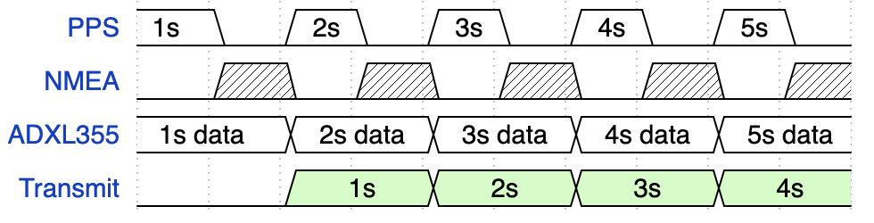
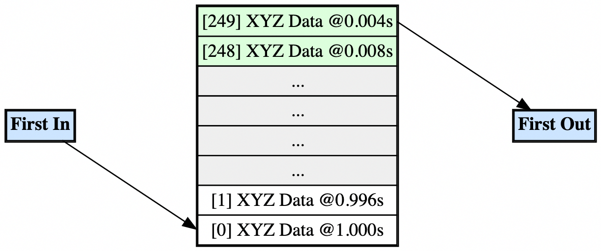
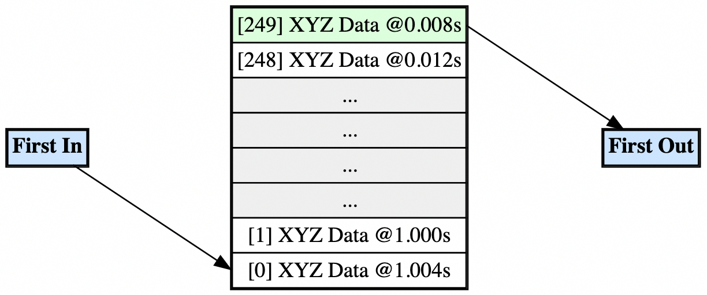

# Notes

## FYIs for maintainer
-I think it would be nice to implement a better time keeping device, this applies to both short range (the ticking every n amount of miliseconds) and long term (time and day/year, etc)
- This implementation is not the best one by any means and it should be mostly rewritten 

## GPS, PPS and Time synchronization

We get a PPS tick and we start collecting data from the ADXL355,
and reading the NMEA sentence thats incoming through the RX.
Once we get the next PPS tick, we package the previous seconds
data and we can transmit it.
<!-- 
{signal: [
  {name: 'PPS',      wave: '2020202020', data:['1s','2s','3s','4s','5s']},
  {name: 'NMEA',     wave: '0x0x0x0x0x'},
  {name: 'ADXL355',  wave: '2.2.2.2.2.', data:['1s data','2s data','3s data','4s data','5s data',]},
  {name: 'Transmit', wave: '0.7.7.7.7.', data:['1s','2s','3s','4s']},
]}
-->

## FreeRTOS Tasks

A pattern of FreeRTOS might(is?) be to start all tasks but
keep them blocked until we need them.

We have a main task that fires off the PPS timer,
once we get a tick we keep moving forward with said task
by
fire off new tasks in FreeRTOS
for collecting

## ADXL355

Im thinking a clock for the ADXL355, generated by an STM32 timer.
Then we sample based on what the DRDY pin dictates.
We could (should) implement DRDY pin first, then timer.

# Relevant things in no particular order

- Software fifo for the data (drdy pin and all that)

FIFO graph 1
<!--
digraph g {
    node [shape=record,group=right,height=0.1]
    node0 [label = "{
        <f0> [287] XYZ Data @0.004s |
        <f1> [286] XYZ Data @0.008s |
        <f2> ... |
        <f3> ... |
        <f4> ... |
        <f5> ... |
        <f6> [1] XYZ Data @0.996s |
        <f7> [0] XYZ Data @1.000s }
        "];
    node1 [label="{<f0> First In}"];
    node2 [label="{<f0> First Out}"]
    "node1":f0 -> "node0":f7;
    "node0":f0 -> "node2":f0
}
-->
Fifo graph 2
<!--
digraph g {
    node [shape=record,group=right,height=0.1]
    node0 [label = "{
        <f0> [287] XYZ Data @0.008s |
        <f1> [286] XYZ Data @0.012s |
        <f2> ... |
        <f3> ... |
        <f4> ... |
        <f5> ... |
        <f6> [1] XYZ Data @1.000s |
        <f7> [0] XYZ Data @1.004s }
        "];
    node1 [label="{<f0> First In}"];
    node2 [label="{<f0> First Out}"]
    "node1":f0 -> "node0":f7;
    "node0":f0 -> "node2":f0
}
-->
<!--
digraph g {
    node [shape=plain]

    node0 [
        label=<
        <TABLE BORDER="1" CELLBORDER="1" CELLSPACING="0">
            <TR><TD PORT="f0" BGCOLOR="#ffdddd">[287] XYZ Data @0.004s</TD></TR>
            <TR><TD PORT="f1" BGCOLOR="#ddffdd">[286] XYZ Data @0.008s</TD></TR>
            <TR><TD PORT="f2" BGCOLOR="#eeeeee">...</TD></TR>
            <TR><TD PORT="f3" BGCOLOR="#eeeeee">...</TD></TR>
            <TR><TD PORT="f4" BGCOLOR="#eeeeee">...</TD></TR>
            <TR><TD PORT="f5" BGCOLOR="#eeeeee">...</TD></TR>
            <TR><TD PORT="f6" BGCOLOR="#ddddff">[1] XYZ Data @0.996s</TD></TR>
            <TR><TD PORT="f7" BGCOLOR="#ffffcc">[0] XYZ Data @1.000s</TD></TR>
        </TABLE>
        >
    ];

    node1 [
        shape=plain
        label=<
        <TABLE BORDER="1" CELLBORDER="1" CELLSPACING="0">
            <TR><TD PORT="f0" BGCOLOR="#cce5ff"><B>First In</B></TD></TR>
        </TABLE>
        >
    ];

    node2 [
        shape=plain
        label=<
        <TABLE BORDER="1" CELLBORDER="1" CELLSPACING="0">
            <TR><TD PORT="f0" BGCOLOR="#cce5ff"><B>First Out</B></TD></TR>
        </TABLE>
        >
    ];

    node1:f0 -> node0:f7;
    node0:f0 -> node2:f0;
}
-->

## New plan

The adxl355 always collects data, and then we do the syncing while that
happens.

Need to implement a parsing tool to ensure the NMEA sentence was parsed
properly.

We could make it so the 1second timer, initializes the RTC and uses ADD1S
<!--
$GNGGA,165016.000,4124.84374,N,00213.33409,E,1,06,1.8,25.9,M,49.4,M,,*7D
$GNGLL,4124.84397,N,00213.33390,E,165015.000,A,A*49
$GNGSA,A,3,07,,,,,,,,,,,,2.4,1.8,1.6,1*3E
$GNGSA,A,3,11,20,23,32,37,,,,,,,,2.4,1.8,1.6,4*3A
$GPGSV,3,1,09,04,16,065,,05,11,307,,06,44,202,,07,68,105,28,0*6E
$GPGSV,3,2,09,09,48,055,,11,53,266,,16,05,039,,21,43,309,,0*6A
$GPGSV,3,3,09,30,48,187,,0*5D
$BDGSV,2,1,06,10,11,035,,11,08,197,29,20,61,055,24,23,10,037,15,0*79
$BDGSV,2,2,06,32,11,089,29,37,39,083,28,0*76
$GNRMC,165015.000,A,4124.84397,N,00213.33390,E,1.03,314.02,160626,,,A,V*07
$GNVTG,314.02,T,,M,1.03,N,1.90,K,A*2D
$GNZDA,165015.000,16,06,2026,00,00*49
$GPTXT,01,01,01,ANTENNA OK*35

$GNGGA,114535.000,4124.84193,N,00213.33729,E,1,06,4.4,16.7,M,49.4,M,,*72
$GNGLL,4124.84193,N,00213.33729,E,114535.000,A,A*48
$GNGSA,A,3,08,,,,,,,,,,,,8.0,4.4,6.6,1*31
$GNGSA,A,3,13,28,33,38,41,,,,,,,,8.0,4.4,6.6,4*3A
$GPGSV,3,1,12,01,75,029,,02,57,094,,03,69,271,,04,21,183,20,0*66
$GPGSV,3,2,12,08,23,166,23,13,,,25,14,15,267,32,17,36,309,,0*51
$GPGSV,3,3,12,19,06,321,,22,18,285,,28,07,081,,32,21,043,,0*6F
$BDGSV,2,1,05,13,52,131,22,28,84,138,34,33,69,066,36,38,26,133,29,0*70
$BDGSV,2,2,05,41,53,204,25,0*43
$GNRMC,114535.000,A,4124.84193,N,00213.33729,E,0.00,249.26,170626,,,A,V*0A
$GNVTG,249.26,T,,M,0.00,N,0.00,K,A*28
$GNZDA,114535.000,17,06,2026,00,00*49
$GPTXT,01,01,01,ANTENNA OK*35

-->

# Software fifo

# TODO (old)

1. Take into consideration clock issues of ADXL355
2. Maybe add a way to tick every second without software timer
3. Ensure there is only 1 function that modifies a variable, and many readers
4. Need to validate the wavyBackBuf section
5. Better structure for this program
6. Decide on how we will handle data recording, will gps be necessary?
7. Perhaps the spi data buffers should be dma
8. I think we also need a new way of keeping time

I think that time related issues need to be fixed, particularly
the aspect of receiving NMEA data, syncing a clock
and then sending data every second.
We do not have

For timing and alignment, we should use structs and packing/alignment
attributes, instead of wavyfifo buffer shenanigans
For now we are manually adding 22 bytes of padding to ensure 32 byte alignment
